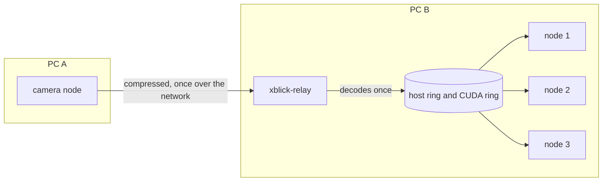

# xblick-relay

[](https://github.com/xblick/xblick) [](https://pypi.org/project/xblick-relay/) [](https://github.com/xblick/xblick-relay/actions/workflows/ci.yml) [](https://github.com/xblick/xblick-relay/blob/main/LICENSE) [](https://github.com/xblick/xblick-relay#install) [](https://zenoh.io)

A [Durchblick](https://github.com/xblick/xblick) node that brings image streams from other PCs
into the rings of this PC. You start one relay per PC. It relays every stream that a node on its PC reads from
another PC: it receives the stream once, decodes each frame once and offers it to every node on the PC through
shared memory and GPU memory. Decoding and publishing take 3.3 ms per frame.

## The problem it solves

A ring is the memory in which a publisher keeps its newest frames for the readers on its own PC. A reader on
another PC cannot open that memory. It receives the stream over the network as `compressed` or `raw`.

With n readers of one remote stream on a PC, the stream crosses the network n times and the PC decodes every frame
n times. No reader receives the frame in GPU memory.

The relay receives the stream once and decodes it once. It then publishes the frames under the same stream name
into a host ring and a CUDA ring on its PC. The readers need no change and no option: a reader with the transport
`auto` asks the relay of its PC for the stream and moves to the relay's ring.



The relay is not specific to one camera. It relays any remote image stream.

## What it publishes

| Topic | Message type | Content |
| --- | --- | --- |
| `<stream>` on the transports `shm` and `cuda` | image stream | The frames of the source, decoded, with the source's header and the attachments `seq` and `source`. |
| `<stream>/info` | info record | The relay's record with `relayed_from: <source host>`. |
| `<camera>/diagnostics` | `diagnostic_msgs/DiagnosticArray` | Status `relay_<stream>` once per second: state, rate, delays and counters. |

`<camera>` is the stream's name without its last part. The relay never offers `raw`, `compressed` or `camera_info`.
Readers receive those from the source.

## Requirements

- Durchblick 0.5. The readers need 0.5 too. The CMake build also needs Durchblick's C++ library.
- For GPU decoding: an NVIDIA GPU and an NVIDIA driver 525 or newer. The wheel brings nvJPEG and the CUDA 12 runtime
  as NVIDIA's pip packages. The CMake build needs a CUDA 12 toolkit with nvJPEG.
- For CPU decoding: no GPU. Start the relay with `--cpu`.
- For the CMake build: CMake 3.22 or newer, Ninja and a C++20 compiler. Installing the wheel needs none of them.
- A [Zenoh router](https://zenoh.io/docs/getting-started/installation/#installing-the-zenoh-router) on the PC (`xblick router` or `zenohd`), as for every Durchblick node.

## Install

```bash
pip install xblick-relay          # or: uv tool install xblick-relay
xblick-relay --help
```

The wheel decodes with nvJPEG on the GPU. It needs the NVIDIA driver on the PC and nothing else: no CUDA toolkit and
no `LD_LIBRARY_PATH`. It depends on NVIDIA's packages `nvidia-nvjpeg-cu12` and `nvidia-cuda-runtime-cu12`, which pip
and uv install with it into the same environment (about 9 MB to download, 19 MB installed). The wheel does not contain
NVIDIA's libraries. Its program opens them from that environment when it starts on a GPU.

On a PC without an NVIDIA GPU, install the wheel in the same way and start the relay with `--cpu`. NVIDIA's packages
are installed there too, and the relay does not load them.

Durchblick's extra `relay` installs the same wheel. Its command `xblick relay` starts the same program:

```bash
pip install "xblick[relay]"
xblick relay --help
```

The wheel runs on Linux on x86-64 with glibc 2.28 or newer (manylinux_2_28). It contains libjpeg and libpng and takes
glibc, libstdc++ and zlib from the system, and `libcuda.so.1` from the NVIDIA driver. PyPI has only this wheel and no
source distribution of `xblick-relay`, because the program builds only against an installed Durchblick C++ library.

`tools/build_wheel.sh` builds the wheel as PyPI has it, in the image `quay.io/pypa/manylinux_2_28_x86_64`. It builds
zenoh-c from source, because the prebuilt zenoh-c needs glibc 2.34. The script's header lists what it needs.

On a system that the wheel does not support, or against a CUDA toolkit of the PC, build the program with CMake:

```bash
cmake -S . -B build -G Ninja -DCMAKE_PREFIX_PATH="<xblick install>;<zenoh install>" \
  -DXBLICK_RELAY_CUDA=ON -DCUDAToolkit_ROOT=<CUDA toolkit>
cmake --build build
cmake --install build --prefix build/install
```

`<zenoh install>` is the prefix of zenoh-c and zenoh-cpp, for example the one that the core's
`tools/install_zenoh.sh <prefix>` installed to. Leave it out when they are in the prefix of Durchblick.
Leave out the two CUDA options for a build without nvJPEG, which decodes on the CPU only. Put `build/install/bin` on
`PATH`, so that `xblick relay` finds the program there. `xblick relay` takes the installed wheel first and `PATH`
second.

## Run

Start one relay on each PC whose nodes read streams from other PCs.

```bash
xblick-relay                # every stream that a reader on this PC asks for, decoded on GPU 0
xblick-relay --cpu          # no GPU: decoded on the CPU, host rings only
xblick-relay --stream robot/ecam24/left robot/ecam24/right     # these streams also without a request
```

`xblick relay` starts the same program with the same options.

Without `--cpu`, the relay decodes with nvJPEG on GPU 0. If it cannot, because the PC has no NVIDIA driver, no such
GPU or no NVIDIA packages beside the wheel, it stops at its start with one line that names the cause. It does not
decode on the CPU unless `--cpu` says so. A build without nvJPEG decodes on the CPU.

| Option | Default | Meaning |
| --- | --- | --- |
| `--stream NAME ...` | none | Streams that the relay relays from its start, also for readers that do not ask. See below. |
| `--cuda-device N` | 0 | Decode with nvJPEG on GPU N and fill a CUDA ring and a host ring. |
| `--cpu` | off | Decode on the CPU and fill the host ring only. Needs no GPU. |
| `--connect ENDPOINT ...`, `--listen ENDPOINT ...`, `--zenoh-mode peer\|client` (also `--mode`) | the PC's router at 127.0.0.1:7447 | The Zenoh session. |
| `--slots N` | 32 | The number of ring slots. 32 slots hold about one second at 30 Hz. |
| `--idle-ms MS` | 2000 | The relay keeps a stream this long after its last reader left. |
| `--prefer-raw` | off | Take the source's `raw` form even where the source offers `compressed`. |

A reader with the transport `auto` asks for a stream by itself. `--stream` is for readers that cannot ask: a reader
with a fixed transport such as `shm`, or a reader with a Durchblick older than 0.3.60.

You can start the relay before or after the readers. A reader with the transport `auto` moves to the relay's ring
when the relay starts, and back to the source's network transport when the relay stops.

A reader needs no option. `ImageSubscriber(session, "robot/ecam24/left")` takes the relay's ring like the ring of
any local publisher. Its `transport_reason` then reads `shm (...)` or `cuda (publisher on this GPU)`.

`--help` lists every option. Every option is also a read-only parameter of the node `xblick/relay_<host>`
(`--node` another name), which Durchblick's terminal interface (`xblick`, tab Parameters) shows. `--param NAME:=VALUE`
or `--params-file FILE` set them at the start.

## Why it is fast

Without a relay, every reader decodes every frame. With the relay, the PC decodes and publishes each frame once in 3.3 ms, and a
reader has the frame 5.1 ms after its capture stamp.

| Change | Effect |
| --- | --- |
| One subscription and one decode per stream for all readers on the PC | The network load and the decode time no longer grow with the number of readers. |
| nvJPEG decodes a JPEG straight into GPU memory. | Readers on the GPU receive a device array without an upload. |
| The relay downloads a frame to the host ring only while a reader of that ring exists. | GPU-only readers cause no download. |
| The relay subscribes to the source only while a local reader exists. | A stream that nobody reads costs no network traffic. |

[docs/performance.md](https://github.com/xblick/xblick-relay/blob/main/docs/performance.md) has the measurement
and explains the relay's status values.

## Limits

- One relay per PC. A second relay on the same PC waits for each stream that the first one relays.
- The relay handles image streams. It does not relay point clouds and it does not rectify.
- The relay decodes every stream on one GPU. A reader on another GPU of the PC copies each frame from there.
- The wheel uses CUDA 12 (nvJPEG and the runtime from NVIDIA's `-cu12` packages).

[docs/design.md](https://github.com/xblick/xblick-relay/blob/main/docs/design.md) explains the reasons and lists
the open work.

## Documentation

| Page | Content |
| --- | --- |
| [docs/design.md](https://github.com/xblick/xblick-relay/blob/main/docs/design.md) | How the relay finds its source, republishes and avoids conflicts |
| [docs/performance.md](https://github.com/xblick/xblick-relay/blob/main/docs/performance.md) | The measured delay and the status values on `<camera>/diagnostics` |
| [docs/testing.md](https://github.com/xblick/xblick-relay/blob/main/docs/testing.md) | How to run the tests and what they check |

Durchblick's concept pages explain the terms used here:
[rings](https://github.com/xblick/xblick/blob/main/docs/concepts/rings.md),
[transports](https://github.com/xblick/xblick/blob/main/docs/concepts/transports.md) with its
section "Relays", and
[sessions and routers](https://github.com/xblick/xblick/blob/main/docs/concepts/sessions.md).

## Origin

Durchblick was started by David Schneider at the
[Computer Vision for Human-Computer Interaction Lab (cv:hci)](https://cvhci.iar.kit.edu) at KIT and is developed
further in cooperation with the [High Performance Humanoid Technologies Lab (H2T)](https://h2t.iar.kit.edu) at KIT.

## Licence

The relay is licensed under the Apache License 2.0
([LICENSE](https://github.com/xblick/xblick-relay/blob/main/LICENSE)).
[NOTICE](https://github.com/xblick/xblick-relay/blob/main/NOTICE) names the copyright holder and the software of
others in the wheel: zenoh-c with the Rust crates it is built from, libjpeg-turbo and libpng. Their licence texts are
in [licenses/](https://github.com/xblick/xblick-relay/tree/main/licenses) and in the wheel. NVIDIA's packages
`nvidia-nvjpeg-cu12` and `nvidia-cuda-runtime-cu12` are not part of the wheel. pip installs them from PyPI under
NVIDIA's licence, which comes with each of them.
