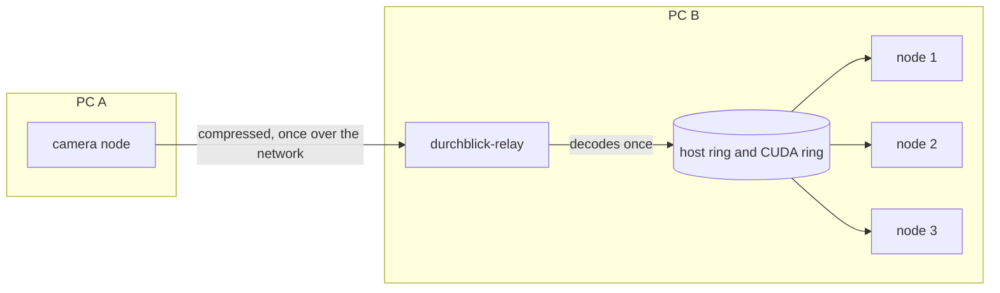

# durchblick-relay

A [Durchblick](https://github.com/xblick/durchblick) node that brings image streams from other PCs
into the rings of this PC. You start one relay per PC. It relays every stream that a node on its PC reads from
another PC: it receives the stream once, decodes each frame once and offers it to every node on the PC through
shared memory and GPU memory. Decoding and publishing take 3.3 ms per frame.

## The problem it solves

A ring is the memory in which a publisher keeps its newest frames for the readers on its own PC. A reader on
another PC cannot open that memory. It receives the stream over the network as `compressed` or `raw`.

With n readers of one remote stream on a PC, the stream crosses the network n times and the PC decodes every frame
n times. No reader receives the frame in GPU memory.

The relay receives the stream once and decodes it once. It then publishes the frames under the same stream name
into a host ring and a CUDA ring on its PC. The readers need no change and no option: a reader with the transport
`auto` asks the relay of its PC for the stream and moves to the relay's ring.



The relay is not specific to one camera. It relays any remote image stream.

## What it publishes

| Topic | Message type | Content |
| --- | --- | --- |
| `<stream>` on the transports `shm` and `cuda` | image stream | The frames of the source, decoded, with the source's header and the attachments `seq` and `source`. |
| `<stream>/info` | info record | The relay's record with `relayed_from: <source host>`. |
| `<camera>/diagnostics` | `diagnostic_msgs/DiagnosticArray` | Status `relay_<stream>` once per second: state, rate, delays and counters. |

`<camera>` is the stream's name without its last part. The relay never offers `raw`, `compressed` or `camera_info`.
Readers receive those from the source.

## Requirements

- Durchblick 0.4, installed with its C++ library. The readers need 0.4 too.
- CMake 3.22 or newer, Ninja and a C++20 compiler.
- For GPU decoding: an NVIDIA GPU and a CUDA 12 toolkit with nvJPEG. Without them the relay decodes on the CPU and
  fills the host ring only.
- A Zenoh router (`zenohd`) on the PC, as for every Durchblick node.

## Install

```bash
cmake -S . -B build -G Ninja -DCMAKE_PREFIX_PATH=<durchblick install> \
  -DDURCHBLICK_RELAY_CUDA=ON -DCUDAToolkit_ROOT=<CUDA toolkit>
cmake --build build
cmake --install build --prefix build/install
```

Leave out the two CUDA options for a build without nvJPEG. We did not execute the last two commands again for this
page.

## Run

Start one relay on each PC whose nodes read streams from other PCs.

```bash
durchblick-relay                # every stream that a reader on this PC asks for
durchblick-relay --cpu          # no GPU: host rings only
durchblick-relay --stream robot/ecam24/left robot/ecam24/right     # these streams also without a request
```

| Option | Default | Meaning |
| --- | --- | --- |
| `--stream NAME ...` | none | Streams that the relay relays from its start, also for readers that do not ask. See below. |
| `--cuda-device N` | GPU 0 if the PC has one | Decode with nvJPEG on GPU N and fill a CUDA ring and a host ring. |
| `--cpu` | | Decode on the CPU and fill the host ring only. |
| `--connect HOST ...`, `--listen ENDPOINT ...`, `--zenoh-mode peer\|client` (also `--mode`) | the PC's router at 127.0.0.1:7447 | The Zenoh session. |
| `--slots N` | 32 | The number of ring slots. 32 slots hold about one second at 30 Hz. |
| `--idle-ms MS` | 2000 | The relay keeps a stream this long after its last reader left. |
| `--prefer-raw` | off | Take the source's `raw` form even where the source offers `compressed`. |

A reader with the transport `auto` asks for a stream by itself. `--stream` is for readers that cannot ask: a reader
with a fixed transport such as `shm`, or a reader with a Durchblick older than 0.3.60.

You can start the relay before or after the readers. A reader with the transport `auto` moves to the relay's ring
when the relay starts, and back to the source's network transport when the relay stops.

A reader needs no option. `ImageSubscriber(session, "robot/ecam24/left")` takes the relay's ring like the ring of
any local publisher. Its `transport_reason` then reads `shm (...)` or `cuda (publisher on this GPU)`.

`--help` lists every option. Every option is also a read-only parameter of the node `durchblick/relay_<host>`
(`--node` another name), which Durchblick's terminal interface (`blick`, tab Parameters) shows. `--param NAME:=VALUE`
or `--params-file FILE` set them at the start.

## Why it is fast

Without a relay, every reader decodes every frame. With the relay, the PC decodes and publishes each frame once in 3.3 ms, and a
reader has the frame 5.1 ms after its capture stamp.

| Change | Effect |
| --- | --- |
| One subscription and one decode per stream for all readers on the PC | The network load and the decode time no longer grow with the number of readers. |
| nvJPEG decodes a JPEG straight into GPU memory. | Readers on the GPU receive a device array without an upload. |
| The relay downloads a frame to the host ring only while a reader of that ring exists. | GPU-only readers cause no download. |
| The relay subscribes to the source only while a local reader exists. | A stream that nobody reads costs no network traffic. |

[docs/performance.md](docs/performance.md) has the measurement and explains the relay's status values.

## Limits

- We tested the relay on one machine only. We have not run it between two PCs, and we have not run relays on two
  PCs at the same time.
- One relay per PC. A second relay on the same PC waits for each stream that the first one relays.
- The relay handles image streams. It does not relay point clouds and it does not rectify.
- The relay decodes every stream on one GPU. A reader on another GPU of the PC copies each frame from there.

[docs/design.md](docs/design.md) explains the reasons and lists the open work.

## Documentation

| Page | Content |
| --- | --- |
| [docs/design.md](docs/design.md) | How the relay finds its source, republishes and avoids conflicts |
| [docs/performance.md](docs/performance.md) | The measured delay and the status values on `<camera>/diagnostics` |
| [docs/testing.md](docs/testing.md) | How to run the tests and what they check |

Durchblick's concept pages explain the terms used here:
[rings](https://github.com/xblick/durchblick/blob/main/docs/concepts/rings.md),
[transports](https://github.com/xblick/durchblick/blob/main/docs/concepts/transports.md) with its
section "Relays", and
[sessions and routers](https://github.com/xblick/durchblick/blob/main/docs/concepts/sessions.md).

## Licence

The relay is licensed under the Apache License 2.0 ([LICENSE](LICENSE)). [NOTICE](NOTICE) names the copyright holder.
